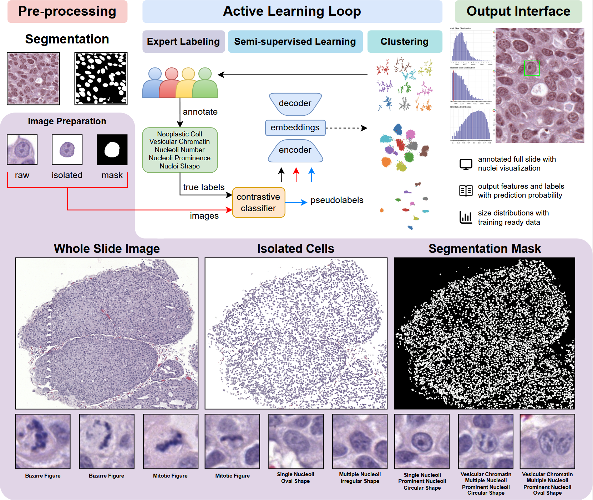
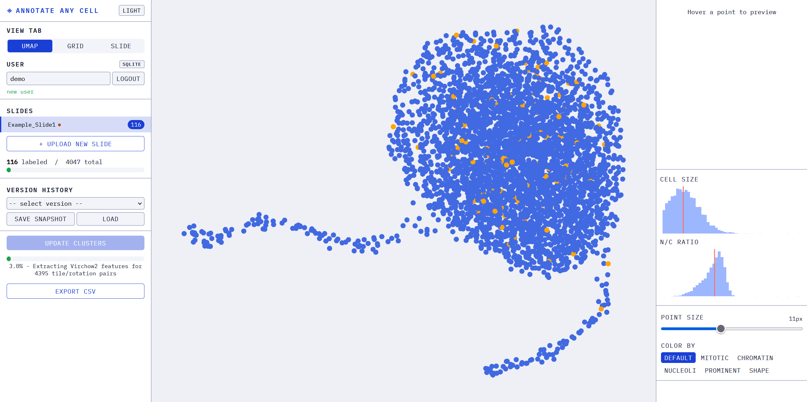
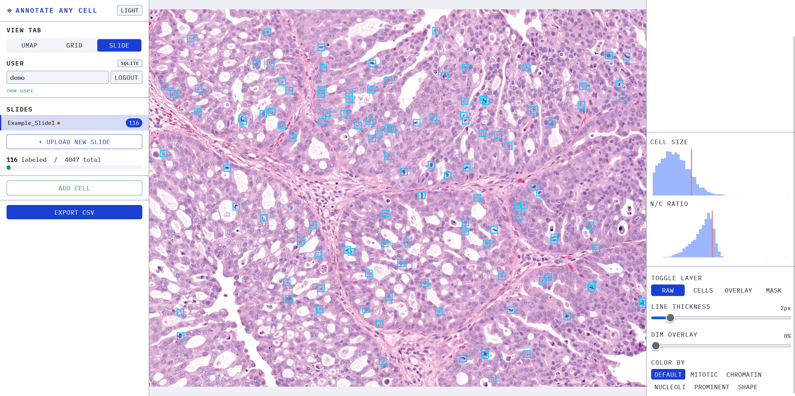

# AnnotateAnyCell

Open-source semi-supervised deep learning framework for cell segmentation, morphological annotation, and active learning in digital pathology.



Upload any histopathology slide (up to **7000 x 7000 px**), segment cells and nuclei automatically with **Cellpose**, explore **Virchow2**-powered morphological predictions across **UMAP**, **Grid**, and **Full-Slide** views, manually lasso missed cells, and fine-tune/re-cluster on the fly.

---

## Interface

| Annotation Workspace | Whole-Slide & Analysis View |
| :---: | :---: |
|  |  |

- **UMAP View**: Interactive WebGL embedding with hover previews, live Cell Size & N/C Ratio histograms, attribute coloring, version snapshots, and **Update Clusters** active learning.
- **Grid View**: Filter Ground Truth (`GT`), AI Predictions (`PRED`), or `ALL` tiles by any combination of morphological attributes.
- **Slide View**: Pan/zoom across `RAW`, `CELLS`, `OVERLAY`, and `MASK` layers, dim unlabeled regions, or click **Add Cell** to outline missed cells manually.
- **Keyboard Shortcuts**: `Enter` (save), Left/Right arrows (prev/next cell), `Esc` (close), and click anywhere on the 512x512 preview to jump to a neighboring cell.

---

## Morphological Attributes

Each segmented cell is classified across 5 biologically constrained heads:

| Attribute | Classes |
| :--- | :--- |
| **Mitotic** | `None`, `Mitotic Figure`, `Bizarre Figure` |
| **Chromatin** | `None`, `Vesicular Chromatin` |
| **Nucleoli** | `None`, `Single Nucleoli`, `Multiple Nucleoli` |
| **Prominent** | `None`, `Prominent Nucleoli` |
| **Shape** | `None`, `Circle`, `Oval`, `Irregular Shape` |

---

## Quick Start

Python 3.10-3.12 with an NVIDIA GPU is recommended (CPU fallback is supported).

```bash
git clone https://github.com/shouryaverma/AnnotateAnyCell.git
cd AnnotateAnyCell

python -m venv .venv
source .venv/bin/activate

# Install PyTorch matching your NVIDIA driver CUDA version (check `nvidia-smi`).
# Example for CUDA 12.x drivers (avoids silent CPU fallback from newer default wheels):
pip install torch torchvision --index-url https://download.pytorch.org/whl/cu128
# For CPU-only machines, use: pip install torch torchvision

# Install app dependencies (Cellpose 3 is pinned for cyto3/nuclei models)
pip install -r requirements.txt

# Verify GPU acceleration (should print CUDA: True on GPU machines)
python -c "import torch; print(torch.__version__, 'CUDA:', torch.cuda.is_available())"

# Launch locally (SQLite storage + bundled Example_Slide1)
./scripts/run_local.sh
```

Open **http://127.0.0.1:5006**, sign in with any username (e.g., `demo`), and start exploring the bundled **`Example_Slide1`** (with precomputed predictions and example labels) right away — or click **+ UPLOAD NEW SLIDE** to upload and preprocess your own `.png`, `.jpg`, or `.tif`/`.tiff` slide (up to `7000 x 7000 px`).

### Virchow2 Access (for New Slide Predictions & Update Clusters)

Extracting features on new slides or running **Update Clusters** uses the gated Hugging Face model [`paige-ai/Virchow2`](https://huggingface.co/paige-ai/Virchow2):

1. Request access at [huggingface.co/paige-ai/Virchow2](https://huggingface.co/paige-ai/Virchow2).
2. Authenticate locally:
   ```bash
   huggingface-cli login
   # or: export HF_TOKEN=hf_your_token_here
   ```

---

## Hosting Online with MongoDB Atlas

By default, the app uses zero-config local **SQLite** (`data/annotator.db`). To run online for multiple users with **MongoDB Atlas**:

```bash
cp .env.example .env
# Edit .env with MONGO_URI (or MONGO_USERNAME/PASSWORD/HOST), MONGO_DB, ALLOWED_USERS, and HF_TOKEN
./scripts/run_mongo.sh
```

---

## CLI Pipelines

```bash
# Preprocess a slide from the command line
python preprocess.py \
  --slide-name MySlide \
  --work-dir ./slides \
  --checkpoint weights/multihead_classifier.pth \
  --mitotic-checkpoint weights/mitotic_classifier.pth

# Run batch predictions on preprocessed slides
python model_predict.py \
  --checkpoint weights/multihead_classifier.pth \
  --mitotic_checkpoint weights/mitotic_classifier.pth \
  --mitotic_threshold 0.9 \
  --slides ./slides/Example_Slide1

# Train the multi-head classifier from scratch
python model_train.py \
  --slide_dirs ./slides/Example_Slide1 \
  --checkpoint_out weights/multihead_classifier.pth
```

---

## Repository Structure

```text
annotator_server.py     # Flask + Waitress web server & SSE progress streaming
storage.py              # Dual persistence backend (SQLite default / MongoDB Atlas)
preprocess.py           # Cellpose segmentation, tiling & initial UMAP
update_clusters.py      # Active-learning fine-tuning, autoencoder & supervised UMAP
update_celladder.py     # Manual lasso cell addition & deletion
model_train.py          # Virchow2 multi-head classifier training
model_predict.py        # Batch inference & valid-combination decoding
mitotic_train.py        # Dedicated mitotic classifier training
mitotic_predict.py      # Dedicated mitotic refinement
templates/ & static/    # Web interface (Plotly.js + HTML5 Canvas)
weights/                # Pretrained multi-head & mitotic checkpoints
slides/                 # Bundled Example_Slide1 and browser-uploaded slides
assets/                 # Documentation figures
scripts/                # Local SQLite and cloud MongoDB launchers
```

---

## Citation

If you use AnnotateAnyCell in your research, please cite:

```bibtex
@article{verma2025annotateanycell,
  title={AnnotateAnyCell: Open-Source AI Framework for Efficient Annotation in Digital Pathology},
  author={Verma, Shourya and Malusare, Aditya and Wang, Mengbo and Wang, Luopin and Mahapatra, Arpan and English, Abigail Leigh and Cox, Abigail D and Broman, Meaghan and de Brot, Simone and Burcham, Grant and others},
  journal={bioRxiv},
  year={2025},
  publisher={Cold Spring Harbor Laboratory}
}
```

## License

Released under the [BSD-3-Clause License](LICENSE).
